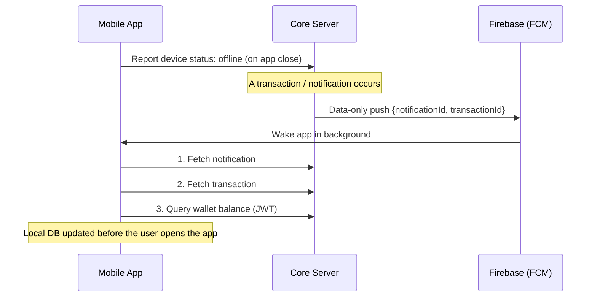

# PayOn Services

> Core backend for **PayOn**, a digital payment system: wallets, peer-to-peer transfers, merchant payments, and privacy-conscious push notifications.


PayOn Services is the **Core Server** of the PayOn platform. It owns authentication and nearly all business operations, and it is consumed by the PayOn mobile app (Kotlin Multiplatform / Jetpack Compose), whose on-device sync engine talks to this server.

---

## Features

- **Authentication & authorization** - stateless JWT with Spring Security
- **Wallets** - balances and wallet operations per user
- **Transactions** - money movement protected by **idempotency keys**, so retries never double-charge
- **Merchants & OnPay** - merchant accounts and payment flows
- **Webhooks** - webhook processing for external payment events
- **Notifications** - real-time via WebSocket, plus FCM data-only push for offline devices
- **Image uploads** - user media with generated thumbnails
- **Observability** - Spring Boot Actuator endpoints

## Architecture

The code follows a **package-by-feature** layout across six domains:

| Domain | Responsibility |
|---|---|
| `auth` | Sign-up / sign-in, JWT issuing and validation |
| `wallet` | Wallet state and balance operations |
| `transactions` | Transfers, idempotent money movement, history |
| `merchant` | Merchant accounts and management |
| `onpay` | Payment flows |
| `notifications` | WebSocket delivery, FCM push, notification log |

### Polyglot persistence

| Store | Used for |
|---|---|
| **PostgreSQL** | Transactional data (users, wallets, transactions) via Spring Data JPA |
| **MongoDB** | Notification and webhook logs |
| **Redis** | Caching and fast ephemeral state |

### Offline-first notification flow

Fintech notifications should not travel through third-party servers, so FCM only carries **IDs**, never content:



## Tech Stack

- **Java 21**, **Spring Boot 4.1.0**, Maven
- Spring Web MVC, Spring Security, Spring Data JPA, Spring Data MongoDB, Spring Data Redis, Spring WebSocket, Bean Validation, Actuator
- JJWT 0.11.5
- Firebase Admin SDK (FCM)
- Docker Compose for local infrastructure
- **Testing:** JUnit 5, Cucumber (BDD), Testcontainers (PostgreSQL, MongoDB)

## Getting Started

### Prerequisites

- JDK 21
- Docker (for PostgreSQL, MongoDB and Redis)

### Run locally

```bash
git clone https://github.com/YousefMoPrince/PayOn-Services.git
cd PayOn-Services

# Starts the services defined in compose.yaml automatically (spring-boot-docker-compose)
./mvnw spring-boot:run
```

On Windows use `mvnw.cmd spring-boot:run`.

### Run the tests

```bash
./mvnw test
```

Integration tests spin up PostgreSQL and MongoDB through Testcontainers, so Docker must be running.

## Development Approach

The project follows a **BDD-first** workflow: *Feature -> Step Definitions -> Implementation*, using Cucumber scenarios as the living specification of each domain.

## Project Structure

```
PayOn-Services
├── src/                 # Application code and tests
├── storage/thumbnails/  # Generated image thumbnails
├── compose.yaml         # Local infrastructure
├── pom.xml              # Maven build
└── mvnw / mvnw.cmd      # Maven wrapper
```

## Related

- **PayOn Android app** - Kotlin Multiplatform client with an on-device sync engine (Ktor + SQLDelight)

## Author

**Yousef Mohamed** - Software Architect & Engineer
[GitHub](https://github.com/YousefMoPrince) · [LinkedIn](https://linkedin.com/in/yousef-elprince)
